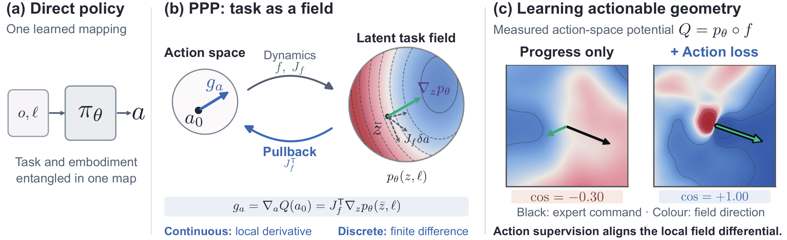

<p align="center">
  <h1 align="center">Progress Predicts Policy</h1>
  <p align="center">
    <a><strong>Licheng Zhong</strong></a>
    ·
    <a><strong>Gim Hee Lee</strong></a>
  </p>
</p>

<h3 align="center">
  <a href="https://zlicheng.com/ppp_page/"><strong>Project Page</strong></a>
  |
  <a href="https://arxiv.org/abs/2611.22491"><strong>arXiv</strong></a>
  |
  <a href="https://huggingface.co/zlicheng/PPP"><strong>HuggingFace</strong></a>
</h3>

<div align="center">
  
</div>

## :rocket: Getting started

| Guide | Contents |
|---|---|
| [Installation and data](docs/installation.md) | environment, LIBERO, downloading data and checkpoints, building the data, hardware notes, the clean-git-tree rule for training |
| [LeWM-based BC and PPP](docs/lewm.md) | world-model pretraining, BC and PPP training, closed-loop evaluation |
| [Seer and Seer-PPP](docs/seer.md) | training and closed-loop evaluation |
| [Released checkpoints](docs/checkpoints.md) | checkpoint layout, reference results, re-running the evaluation |

Quick start, evaluating the released PPP checkpoint:

```bash
conda create -n ppp python=3.10 -y && conda activate ppp
pip install -r requirements.txt --extra-index-url https://download.pytorch.org/whl/cu128
git clone https://github.com/Lifelong-Robot-Learning/LIBERO.git external/LIBERO
git -C external/LIBERO checkout 8f1084e
pip install -e external/LIBERO --no-deps --config-settings editable_mode=compat
python -c "import libero.libero"          # answer N once to create ~/.libero/config.yaml

hf download zlicheng/PPP --local-dir . --include "assets/latent_extract/*" "checkpoints/lewm_*"

CELL_TAG=rerun_settle EXTRA_ARGS="--grip_field_eps_steps 1.0 --pose_grip_settle" VIDEO_ARGS="" \
    bash runs/close_loop_lewm_libero.sh checkpoints/lewm_ppp_libero "checkpoint_120" 2 "0 1 2 3" 0
python scripts/summarize_official_suites.py --run_dir checkpoints/lewm_ppp_libero \
    --cell epseed0_rerun_settle_checkpoint_120
```

## :saluting_face: Acknowledgements

This code builds on [LeWorldModel](https://github.com/le-wm),
[Seer](https://github.com/InternRobotics/Seer),
[LIBERO](https://github.com/Lifelong-Robot-Learning/LIBERO) and
[MAE](https://github.com/facebookresearch/mae).

## :key: License

The code is released under the [Apache License 2.0](LICENSE). Files adapted from LeWorldModel (MIT)
and Seer (Apache-2.0) keep their original licenses; see
[THIRD_PARTY_NOTICES.md](THIRD_PARTY_NOTICES.md). The MAE weights used by the Seer-based models are
under CC BY-NC 4.0.

## :earth_asia: Citation

```bibtex
@article{zhong2026ppp,
    title       = {Progress Predicts Policy},
    author      = {Zhong, Licheng and Lee, Gim Hee},
    journal     = {arXiv preprint arXiv:2611.22491},
    year        = {2026}
}
```

For more questions, please create an GitHub Issue or contact Licheng Zhong: zlicheng@u.nus.edu